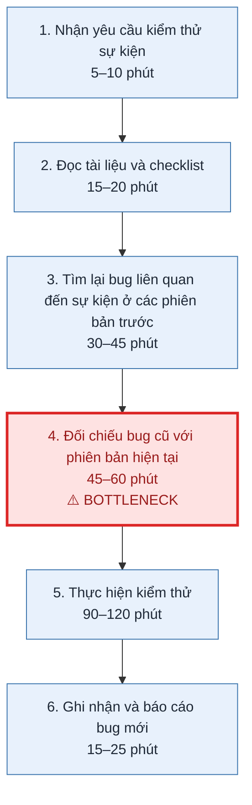
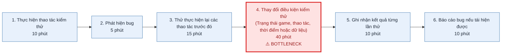
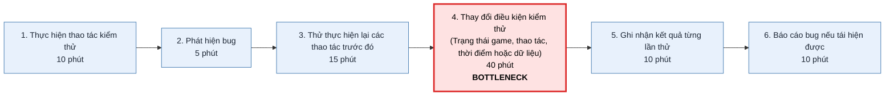

# Báo cáo cá nhân — 04083_TranDinhNhatMinh.md

> Đổi tên file theo quy tắc `MSSV_HoTen.md`, ví dụ `20241234_NguyenVanAn.md` (MSSV trước, dấu `_`, họ tên viết liền không dấu). Sửa cả dòng tiêu đề phía trên cho khớp.
> Template chi tiết và prompt mẫu cho từng mục: [docs/01-worksheet.md](../../docs/01-worksheet.md).
> Mỗi thành viên một file trong `report/individual/` trên repo nhóm: copy template này thành file mới, điền, rồi commit bằng tài khoản GitHub của bạn. Không viết hộ người khác.

## 1. Thông tin học viên

- Họ tên: Trần Đình Nhật Minh
- MSSV: 2A202604083
- Email trường (không bắt buộc, repo có thể để public):
- Tên nhóm: Nnhom123
- Link repo nhóm: https://github.com/trandinhnhatminh1452/K5-L3B-DAY02-Nnhom123-DiscoveryProblemFraming.git

---

## 2. Scan problem (CP1)

Lăng kính: **Lặp lại** · **Tốn thời gian** · **Cần đọc, tổng hợp nhiều thông tin** · **Pain từ người khác**.

| # | Lăng kính | Job Story: Khi… tôi muốn… để… | Ai chịu ảnh hưởng? | Dấu hiệu thật (thời gian, tần suất, số người, bằng chứng) |
|---:|---|---|---|---|
| 1 |Lặp lại |Khi kiểm thử một sự kiện được mở hàng tháng trong game, tôi muốn tra cứu các bug từng xuất hiện ở những phiên bản trước, để tránh bỏ sót những lỗi tương tự. | QA Tester, QA Leader|1-2 tháng một lần, mỗi lần 3-4 tiếng |
| 2 |Tốn thời gian |Khi phát hiện một bug chỉ xuất hiện trong điều kiện nhất định, tôi muốn xác định được điều kiện tái hiện lỗi, để không phải thử đi thử lại nhiều lần.|QA Tester, Developer |Mỗi lần thử mất khoảng 10p cho từng trường hợp, những bug nó chỉ diễn ra ngẫu nhiên trong một trường hợp cố định phải mất 15-20 phút để có thể tái  |
| 3 |Tốn thời gian |Khi kiểm tra một checklist dài, tôi muốn biết chính xác những mục đã kiểm tra và chưa kiểm tra, để tránh mất thời gian rà soát lại nhiều lần. |QA Tester |Một checklist có khoảng 50–100 mục; mất thêm 10–15 phút rà soát trạng thái trước khi kết thúc kiểm thử. |
| 4 |Cần đọc, tổng hợp nhiều thông tin |Khi nhận một tính năng mới để kiểm thử, tôi muốn nắm được các yêu cầu và thay đổi so với phiên bản trước, để xác định chính xác phạm vi cần kiểm tra. |QA Tester, Developer |mất khoảng 15–20 phút đọc khoảng các nguồn thông tin như tài liệu, ticket và trao đổi trong nhóm. |
| 5 |Pain từ người khác |Khi Developer thông báo đã sửa bug, tôi muốn biết chính xác những nội dung đã thay đổi, để xác định các khu vực cần kiểm thử lại. |QA Tester, Developer |Mỗi lần thử lại có khoảng 2–3 trường hợp phải hỏi lại Developer về phạm vi sửa lỗi; mất khoảng 10 phút xác nhận. |

**Nếu có dùng AI để gợi ý thêm:** ý nào AI gợi ý mà bạn giữ lại, ý nào bỏ và vì sao.

-

---

## 3. Top 3 Problem Cards + quy trình nháp (CP2)

### Bảng chọn top 3

| Rank | Problem | Vì sao chọn | Điều còn chưa chắc |
|---:|---|---|---|
| 1 |Tra cứu bug cũ khi kiểm thử sự kiện hàng tháng(#1) |Quy trình rõ, tốn thời gian, lặp lại nhiều lần |Thời gian kiểm tra tùy vào từng bug, không cố  |
| 2 |Khó tái hiện bug xuất hiện ngẫu nhiên(#2) |Tốn thời gian |Điều kiện xuất hiện không cố đinh, phải thử nhiều trường  |
| 3 |Không rõ phạm vi sửa bug của Developer(#5) |Mất nhiều thời gian để xác nhận |Chưa biết thông tin nào thường bị thiếu khi Developer thông báo sửa bug. |

### Problem Card #1

| Trường | Nội dung |
|---|---|
| Job Story | Khi kiểm thử một sự kiện được mở lại hàng tháng, tôi muốn tra cứu các bug từng xuất hiện ở những phiên bản trước, để tránh bỏ sót lỗi tương tự. |
| Actor | QA Tester. |
| Thời điểm / bối cảnh | Khi sự kiện được mở lại, khoảng 1–2 tháng/lần. |
| Quy trình hiện tại (3–7 bước) | 1. Nhận yêu cầu kiểm thử sự kiện. 2. Đọc tài liệu và checklist. 3. Tìm lại bug liên quan đến sự kiện ở các phiên bản trước. 4. Đối chiếu bug cũ với phiên bản hiện tại. 5. Thực hiện kiểm thử. 6. Ghi nhận và báo cáo bug mới. |
| Bottleneck (bước nào, mất bao nhiêu phút) | Bước 3–4: Tìm kiếm và đối chiếu bug cũ. Chưa có số liệu đo riêng; tổng thời gian kiểm thử toàn bộ sự kiện khoảng 3–4 tiếng. |
| Impact (nếu không giải thì sao) | Có thể bỏ sót lỗi đã từng xuất hiện, mất thời gian tìm lại thông tin và kiểm thử lại những trường hợp không cần thiết. |
| Success metric (baseline → target) | Giảm thời gian tìm kiếm và kiểm thử xuống 30-40%. |
| Phương án không dùng AI | Chuẩn hóa cách đặt tên bug, gắn tag theo sự kiện, xây dựng danh sách bug cũ và bộ lọc tìm kiếm. |
| Giả thuyết về AI (nếu có) | AI có thể tìm các bug có nội dung tương tự dù cách mô tả khác nhau, sau đó gợi ý những bug QA cần chú ý. |
| Cảm nhận nhanh | Workflow / Có thể cần AI hỗ trợ tìm kiếm ngữ nghĩa. |

Quy trình nháp hiện tại:

### Problem Card #2

| Trường | Nội dung |
|---|---|
| Job Story | Khi phát hiện một bug chỉ xuất hiện trong một số điều kiện nhất định, tôi muốn xác định được các điều kiện tái hiện lỗi, để không phải thử đi thử lại nhiều lần. |
| Actor | QA Tester phát hiện và xác minh bug; Developer hỗ trợ phân tích khi cần. |
| Thời điểm / bối cảnh | Khi kiểm thử chức năng và gặp lỗi không xuất hiện ổn định sau mỗi lần thực hiện thao tác. |
| Quy trình hiện tại (3–7 bước) | 1. Thực hiện thao tác kiểm thử. 2. Phát hiện bug. 3. Thử thực hiện lại các thao tác trước đó. 4. Thay đổi điều kiện kiểm thử như trạng thái game, thao tác, thời điểm hoặc dữ liệu. 5. Ghi nhận kết quả từng lần thử. 6. Báo cáo bug nếu tái hiện được. |
| Bottleneck (bước nào, mất bao nhiêu phút) | Bước 4: Thay đổi điều kiện kiểm thử. Một số bug khó tái hiện có thể mất 40 phút. |
| Impact (nếu không giải thì sao) | Tốn thời gian kiểm thử, chậm xác minh bug và có thể không cung cấp đủ thông tin để Developer sửa lỗi. |
| Success metric (baseline → target) | Thời gian trung bình để tái hiện một bug giảm 30%, tìm ra phương án tái hiện tốt . |
| Phương án không dùng AI | Lập checklist điều kiện kiểm thử, ghi lại log, thao tác, trạng thái game và kết quả từng lần thử. |
| Giả thuyết về AI (nếu có) | AI có thể phân tích lịch sử thử nghiệm và log để gợi ý những điều kiện có khả năng gây ra bug. |
| Cảm nhận nhanh | Workflow |

Quy trình nháp hiện tại:

### Problem Card #3

| Trường | Nội dung |
|---|---|
| Job Story | Khi Developer thông báo đã sửa bug, tôi muốn biết chính xác những nội dung đã thay đổi, để xác định các khu vực cần kiểm thử lại. |
| Actor | QA Tester thực hiện retest và Developer phụ trách sửa bug. |
| Thời điểm / bối cảnh | Khi Developer chuyển trạng thái bug sang đã sửa và yêu cầu QA kiểm tra lại. |
| Quy trình hiện tại (3–7 bước) | 1. Nhận thông báo Developer đã sửa bug. 2. Mở ticket hoặc bug report ban đầu. 3. Đọc thông tin sửa lỗi được cung cấp. 4. Nếu chưa rõ, hỏi Developer về nội dung và phạm vi sửa. 5. Xác định các trường hợp cần retest. 6. Thực hiện retest và cập nhật kết quả. |
| Bottleneck (bước nào, mất bao nhiêu phút) | Bước 4: Làm rõ nội dung và phạm vi sửa lỗi. Theo thông tin ban đầu, mỗi lần retest có khoảng 2–3 trường hợp phải hỏi lại Developer, mất khoảng 10 phút xác nhận. |
| Impact (nếu không giải thì sao) | Retest chậm, có thể kiểm tra thiếu trường hợp liên quan hoặc bỏ sót lỗi phát sinh sau khi sửa. |
| Success metric (baseline → target) | Số lần phải hỏi lại Developer và thời gian xác nhận: baseline cần đo → mục tiêu giảm 50% số lần hỏi lại. |
| Phương án không dùng AI | Chuẩn hóa mẫu thông báo sửa bug, yêu cầu Developer ghi rõ nguyên nhân, nội dung thay đổi và phạm vi ảnh hưởng. |
| Giả thuyết về AI (nếu có) | AI có thể đọc bug report và nội dung sửa lỗi để đề xuất các khu vực, chức năng liên quan cần retest. |
| Cảm nhận nhanh | Rule / Workflow |

Quy trình nháp hiện tại:

### Card muốn pitch nhất

**Card số:** 2 — Khó tái hiện bug xuất hiện ngẫu nhiên.
**Vì sao:** Đây là vấn đề tôi gặp trong quá trình kiểm thử thực tế. Khi bug không xuất hiện ổn định, QA phải thử lại nhiều lần và thay đổi các điều kiện kiểm thử để tìm cách tái hiện. Việc này tốn thời gian, làm chậm quá trình xác minh bug và đôi khi khiến Developer thiếu thông tin để xử lý.
**Câu hỏi muốn nhóm phản biện:** Có cách nào giúp QA xác định nhanh các điều kiện gây ra bug mà không phải thử quá nhiều trường hợp? Liệu vấn đề này có thực sự cần AI hay có thể giải quyết bằng cách ghi log và chuẩn hóa quy trình kiểm thử?

### AI đã phản biện card thế nào

| Điểm yếu AI chỉ ra | Đồng ý? | Đã sửa gì |
|---|---|---|
| Actor chưa đủ cụ thể, chưa xác định rõ QA phụ trách loại game, chức năng hoặc công đoạn kiểm thử nào. | Đồng ý | Xác định rõ phạm vi công việc và vai trò của QA trong quy trình. |
| Quy trình hiện tại chưa được xác thực bằng tình huống thực tế, có thể chỉ là quy trình giả định. | Đồng ý |Dẫn một vài bug cụ thể và ghi lại các bước xử lý thực tế khi gặp bug. |
---

## 4. Tôi đã tham gia phần nào (CP3 → CP7)

| Hoạt động | Tôi đã làm gì? | Kết quả / ảnh hưởng tới bài nhóm |
|---|---|---|
| Pitch Problem Card |Trình bày 3 vấn đề liên quan đến công việc QA: tra cứu bug cũ, tái hiện bug ngẫu nhiên và làm rõ phạm vi sửa bug. |Có 3 candidate problem để nhóm xem xét và lựa chọn 1 trong  |
| Phản biện bài của bạn khác | Câu hỏi tôi đã đặt:Dùng công cụ checklist thông thường có giải quyết được không?  Thông tin phân tán ở nhiều nơi, AI đọc có bị sót ngữ cảnh không?  |Giúp hiểu hơn về vấn đề nhóm đang giải quyết, xem thử các phương án khác nhau và độ tối ưu của chúng |
| Nhận phản biện | Câu hỏi tôi nhận được: Có chắc chắn bug cũ sẽ lặp lại ở phiên bản mới không? Việc tái hiện phụ thuộc vào môi trường hay data? Có cần thiết lập rule tự động mapping giữa bug và commit code không?|Tôi nhận ra không thể mặc định bug cũ sẽ xuất hiện lại ở phiên bản mới. Cần xem xét thêm sự khác biệt về phiên bản, môi trường và dữ liệu kiểm thử. Tôi cũng nhận thấy việc mapping bug với commit code chỉ nên là thông tin hỗ trợ, không phải điều kiện bắt buộc. Vì vậy, cần kiểm chứng tính cần thiết và độ tin cậy của dữ liệu trước khi đề xuất tự động hóa. |
| Gom cluster / cây OST | | |
| Chọn candidate problem | | |
| Kiểm chứng / research | | |
| Quy trình nhóm | | |
| Problem Statement |Xây dựng Problem Statement v0 và cập nhật thành v1 |Làm rõ Actor, Impact, Success Metric, Boundary |
| Mức can thiệp AI |So sánh No AI, Rule, Workflow và Agent; lựa chọn Workflow. | AI hỗ trợ tổng hợp lịch sử và đề xuất điều kiện kiểm thử, QA vẫn là người quyết định. |
| Quyết định |Đánh giá 4 rủi ro Value, Usability, Feasibility và Viability. | Chọn Not Yet, cần kiểm chứng dữ liệu và thử nghiệm pilot trước khi triển khai. |

---

## 5. Dùng AI

| Checkpoint | Tôi dùng AI để làm gì? | AI hữu ích ở đâu? | AI sai hoặc hời hợt ở đâu? | Tôi sửa gì bằng nhận định của mình? |
|---|---|---|---|---|
| CP1 Scan | | | | |
| CP2 Problem Card | | | | |
| CP4 Research | | | | |
| CP5 Quy trình | | | | |
| CP5–6 Problem Statement | Hỗ trợ xác định Boundary, AI intervention point. | Giúp làm rõ vai trò của AI, con người và tiêu chí đánh giá. | Một số tiêu chí đo lường và khả năng triển khai chưa có bằng chứng xác thực. | Bổ sung cách đo thời gian tái hiện bug, yêu cầu QA xác nhận và xác định các giả định cần kiểm chứng. |
| CP6 Mức can thiệp / quyết định | So sánh No AI, Rule, Workflow, Agent và đánh giá 4 rủi ro. | Giúp phân tích ưu, nhược điểm và lựa chọn mức can thiệp phù hợp. | Ban đầu đề xuất Agent có phần phức tạp so với dữ liệu hiện có. | Chọn Workflow, quyết định Not Yet và đặt ngưỡng dừng trước khi triển khai rộng. |

---

## 6. Reflection (CP7)

Trả lời bằng trải nghiệm thật của bạn, tối thiểu 200 từ cho các câu 6.1–6.6 (không tính 6.7, câu này được chấm riêng ở tiêu chí C5). **Không dùng AI để viết thay.**

**6.1. Tôi học được gì khi nghe top 3 problems của các bạn khác?**: Khi nghe các vấn đề của các bạn, tôi nhận ra mỗi người có những khó khăn và góc nhìn khác nhau. Có những vấn đề ban đầu tưởng chừng đơn giản nhưng lại ảnh hưởng đáng kể đến thời gian và hiệu quả công việc. Tôi học được rằng cần nhìn nhận vấn đề từ trải nghiệm thực tế, không nên vội đánh giá hay đề xuất giải pháp khi chưa hiểu rõ nguyên nhân.

**6.2. Nhóm có lúc nào bị "solution-first" (nghĩ giải pháp trước khi hiểu vấn đề) không? Lúc đó nhóm nhận ra và xử lý thế nào?** Nhóm đã có bị xảy rả trường hợp solution-first, khi nghe đến vấn đề cần giải quyết thì có nhiều người liền đề xuất tự động hóa bằng AI, những đã có người phản bác và chỉ ra các phần còn thiếu và bottleneck trong việc áp dụng AI ngay lập tức. Nhóm đã cùng bàn bạc lại và quyết định tìm hiểu và phân tihcs quy trình và xem việc áp dụng AI để tự động hóa có khả thi không

**6.3. Tôi có đổi ý sau khi bị phản biện không? Kể một lần cụ thể.** Ban đầu, tôi khá tập trung vào việc sử dụng AI để hỗ trợ QA tái hiện bug. Tuy nhiên, sau khi mọi người đưa ra ý kiến, tôi nhận ra chưa có baseline thực tế và chưa chứng minh được dữ liệu đủ tốt để AI phân tích. Vì vậy, tôi đã thay đổi quyết định AI chỉ đưa ra gợi ý, còn QA là người kiểm tra và quyết định.

**6.4. Kết quả kiểm chứng (phỏng vấn/survey/research) có làm tôi bất ngờ không? Điều gì?**

**6.5. Điều khó nhất khi viết Problem Statement là gì?** Khó nhất là xác định chính xác bottleneck và xây dựng Success Metric có thể đo lường được. Tôi chỉ biết việc tái hiện bug tốn nhiều thời gian nhưng chưa phân biệt được thời gian dành cho việc thử lại thao tác và thay đổi điều kiện kiểm thử. Ngoài ra, tôi cũng phải xác định rõ giới hạn của AI và vai trò kiểm soát của QA.

**6.6. Nếu làm lại, tôi sẽ đổi gì? Tôi sẽ phản biện nhóm mạnh hơn ở điểm nào?** Nếu được làm lại, tôi sẽ khảo sát kỹ hơn các nhân viên QA, thu thập dữ liệu để có baseline chính xác thay vì dựa vào ước tính. Tôi cũng sẽ thử nghiệm checklist và quy trình ghi nhận thông tin trước khi đề xuất AI. Khi phản biện nhóm, tôi sẽ tập trung nhiều hơn vào dữ liệu đầu vào và bằng chứng chứng minh giải pháp thực sự tốt hơn quy trình hiện tại.

**6.7. Hiểu bài:** giải thích bằng 5–8 câu, không nhìn tài liệu, chuỗi *problem → quy trình → metric → boundary → mức can thiệp AI → quyết định* của bài nhóm mình.  
Với bài tập của nhóm tôi, chúng tôi đang tập trung giải quyết vấn đề QA gặp khó khăn khi tái hiện những bug xuất hiện không ổn định trong quá trình kiểm thử game. Quy trình hiện tại là QA thực hiện thao tác, phát hiện bug, thử lại các thao tác trước đó, thay đổi điều kiện kiểm thử và ghi nhận kết quả, trong đó việc thử lại và tìm điều kiện gây lỗi là bottleneck. Về Boundary, AI chỉ được phép tổng hợp thông tin và đề xuất điều kiện kiểm thử, không tự kết luận nguyên nhân, thay đổi trạng thái game hay đóng bug. Nhóm chọn mức can thiệp Workflow, trong đó AI hỗ trợ tổng hợp lịch sử kiểm thử và gợi ý các bước tiếp theo. QA vẫn là người đánh giá đề xuất, lựa chọn điều kiện và xác nhận kết quả bằng kiểm thử thực tế. Cuối cùng, nhóm quyết định Not Yet, chưa triển khai rộng mà cần kiểm tra chất lượng log, thử nghiệm trên một số bug thực tế và đánh giá hiệu quả trước khi tiếp tục.

---

## 7. Tài liệu tham khảo

-
